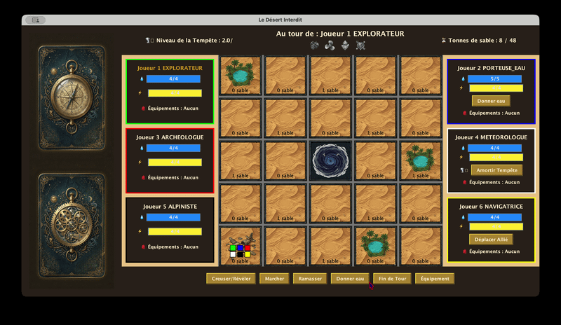

# Forbidden Desert (*Le Désert Interdit*)

## Description

This project is a digital adaptation of the cooperative board game **Forbidden Desert** (*Le Désert Interdit*), developed in **Java** using **Swing**. 

You play as a team of adventurers who survived a crash landing and are stranded in a shifting desert with a limited water supply. To win, you must work together to survive, excavate buried ruins, uncover clues, and collect the four missing flying machine parts before the relentless sandstorm buries you or you run out of water. You will discover the unique abilities of each role, equipment cards, and desert tiles as you play or by consulting the rules.

---

## Demo



---

## How to Run the Game

### Prerequisites
* **Java Development Kit (JDK) / JRE:** Version 8 or higher.

### Option 1: Playable Release Archive (Recommended)
1. Go to the **[Releases](../../releases)** section on the right side of this repository and download **`LeDesertInterdit.zip`**.
2. **Extract the `.zip` archive** (make sure to keep `LeDesertInterdit.jar` and the `src/` resource folder together in the same directory).
3. Double-click **`LeDesertInterdit.jar`**, or launch it from your terminal inside the extracted folder:
   ```bash
   java -jar LeDesertInterdit.jar
   ```

### Option 2: Build & Run from Source (IntelliJ IDEA / CLI)
1. Clone the repository:
   ```bash
   git clone [https://github.com/](https://github.com/)Mieow-ai/Le-desert-interdit.git
   cd Le-desert-interdit
   ```
2. Open the project in **IntelliJ IDEA** and run `Main.java`, or compile and run via terminal from the project root:
   ```bash
   javac -d out src/**/*.java
   java -cp out Main
   ```
   
---

## 1. Implemented Features

We implemented the full ruleset and mechanics of the original board game:
* **Graphical User Interface (Java Swing):** Start menu, interactive desert board, player dashboards with special action buttons, card deck views, delayed visual animations for storm actions, and collectible items appearing on the board.
* **Multiplayer (2 to 6 Players):** Implementation of all 6 original roles with their unique abilities:
  * *Archaeologist, Climber, Explorer, Meteorologist, Navigator, Water Carrier.*
* **Core Board Game Mechanics:**
  * Sandstorm management (eye of the storm movement, sand tile accumulation).
  * Water reserve system and water sharing between adjacent players.
  * Clue discovery and spawning of the 4 flying machine parts (*Engine, Propeller, Solar Crystal, Navigation Deck*).
  * Equipment cards (*Jetpack, Dune Blaster, Terrascope, Solar Shield, Time Throttle, and Secret Water Reserve*).
* **Audio:** Integrated background music and interactive sound effects.

---

## 2. Software Architecture & Design Choices

### A. Global Architecture: Model-View-Controller (MVC)
The entire project is strictly separated into three main components:
* **Model:** Handles the core game logic (movement, sand levels, water reserves, player actions) completely independently of any graphical interface.
* **View:** Built with Java Swing, responsible solely for rendering the current state of the Model. All view classes redraw components (via `paintComponent` or `GridBagLayout`) by reading data from the Model.
* **Controller:** Handles user input (mouse clicks and buttons), interprets events, updates the Model through its methods, and triggers UI refreshes.
* *Note:* The only exception to strict MVC separation is the use of Swing dialog pop-ups directly from the controller for simplicity and cleaner code flow.

### B. Dynamic Updates: Observer / Observable Pattern
To keep the Model decoupled from the View, we implemented the **Observer / Observable** design pattern. The Model holds no direct references to the GUI. Instead, core objects (such as `Plateau`) inherit from our `Observable` class, while `VuePlateau` (and other views) subscribe as `Observer` instances. Whenever a game mechanic alters the state (e.g., the storm moves or a player excavates a tile), the board notifies its observers, automatically triggering a UI repaint.

### C. Inheritance & Abstract Polymorphism
Internal classes rely on polymorphic behavior:
* **Role Modeling:** An abstract `Joueur` class encapsulates standard actions (move, drink, excavate). Each specific role (`Alpiniste`, `Explorateur`, etc.) inherits from `Joueur` and overrides relevant methods. For example, `Explorateur` overrides `getDirections()` to enable diagonal movement and excavation without altering the main game loop.
* **Terrain Modeling:** Similarly, the abstract `Zone` class defines the baseline behavior of a desert tile (holding players, accumulating sand). Subclasses (`ZoneEau`, `ZoneTunnel`, `ZoneIndice`) override `actionReveler()` to automatically trigger unique effects (granting water, acting as a teleportation tunnel) without heavy controller intervention.

### D. Factory Pattern
To centralize and safeguard the instantiation of polymorphic objects, we use static factory methods (`Zone.creerZone(...)` and `Joueur.creerJoueur(...)`). During random board generation or lobby setup, the system passes an `Enum` representing the desired component, and the factory returns the properly configured subclass instance.

### E. State Machine in the Controller
To cleanly manage user interactions, the `Controleur` class relies on an explicit state machine (managed via an `Enum`). This contextualizes player clicks: if the current state is `DEPLACEMENT` (Move), clicking a tile invokes `setZone()`; if the state is `CREUSER` (Excavate), clicking the same tile invokes `creuserZone()`.

### F. Project Structure
* **`modele/`**: Core business logic.
  * Board grid and sandstorm management (`Plateau`).
  * Polymorphic tiles (`Zone`, `ZoneCrash`, `ZoneTunnel`, etc.) and player roles (`Joueur`, `Alpiniste`, etc.).
  * Deck and discard pile management (`Paquet`, `CarteTempete`, `CarteEquipement`).
* **`vue/`**: Graphical User Interface (Swing).
  * Main window (`FenetreJeu`) and dedicated views (`VuePlateau`, `VueJoueur`, `VueCommande`, etc.).
  * `Theme` class centralizing visual styling.
  * Audio asset management via the `Son` class.
* **`controleur/`**: Bridge between the Model and the View.
  * `Controleur` manages user interactions (mouse clicks, buttons) via a state machine (`enum action`).

---

## 3. Known Limitations

* **Navigator Ability:** To our knowledge, the only rule difference from the physical board game concerns the Navigator: in our implementation, the Navigator can move another player by **1 tile** per action instead of up to **3 tiles** per action. Implementing variable 1-to-3 tile movement within a single action point would have required significant additional state handling, which was omitted due to time constraints.
* **Item Stacking on Tiles:** If two collectible items spawn on the exact same tile before the first one is picked up, the previous item is overwritten (a rare edge case during standard gameplay). Refactoring tile item storage into a list structure would have required widespread changes across the codebase.

---

## 4. External Assets & Acknowledgments

* **Artwork & Visuals:** All game illustrations and icons were generated using **Nano Banana 2** (Google's image generation model).
* **Audio:** Sound effects and music were sourced from YouTube and [101soundboards](https://www.101soundboards.com/).
* **Cross-Platform Swing Styling:** Custom button colors and dimensions initially failed to render on macOS until applying the cross-platform LookAndFeel snippet from the [Oracle Java Swing Documentation](https://docs.oracle.com/javase/tutorial/uiswing/lookandfeel/plaf.html#available):
  ```java
  try {
      UIManager.setLookAndFeel(UIManager.getCrossPlatformLookAndFeelClassName());
  } catch (Exception _) {}
  ```
